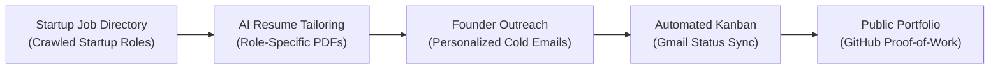
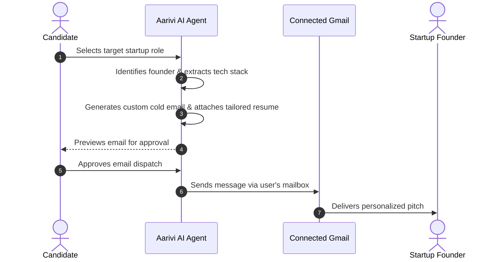
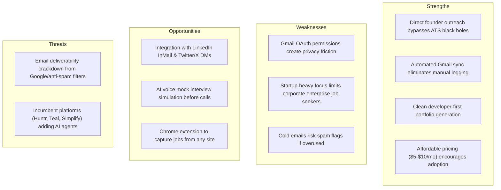

# Aarivi (aarivi.com) — In-Depth Website & Feature Analysis

> **Target Platform:** [aarivi.com](https://aarivi.com/)  
> **Platform Type:** AI-Powered Startup Job Hunting & Career Autopilot Platform  
> **Author/Maker:** Vineeth (`@vineeth_agi`)  
> **Analysis Date:** October 2026  
> **Prepared For:** CareerPilot / AI Job Application Analyzer Product Strategy

---

## 1. Executive Summary

**Aarivi** is a modern, bootstrapped AI SaaS platform designed to put the tech startup job hunt on "autopilot." Rather than functioning as a standard job aggregator or resume scanner, Aarivi positions itself as an **end-to-end autonomous agent for candidates**, bridging the gap between discovering startup opportunities, pitching founders directly, tracking application statuses, and showcasing developer proof-of-work.

### Core Value Proposition
> *"Stop spending hours managing spreadsheets, filling repetitive application forms, and drafting cold emails from scratch. Focus entirely on interview preparation while Aarivi automates the administrative busywork."*

---

## 2. Core Feature Breakdown

### 2.1. Curated Startup Job Directory
* **Aggregated Roles:** Automatically aggregates and continuously updates open tech roles from thousands of startups, Y Combinator directories, and public career portals.
* **Smart Filtering:** Candidates can filter jobs by:
  - Startup funding stage (Pre-Seed, Seed, Series A–C)
  - Tech stack & engineering domain (Full Stack, Backend, AI/ML, DevOps)
  - Work arrangement (Remote, Hybrid, In-Person by city)
* **Direct Application & Outreach Hooks:** Each job card includes direct triggers to either create a tailored resume or draft a cold outreach message to the founder.

---

### 2.2. Direct Founder Outreach Engine (Signature Feature)
The single biggest differentiator for Aarivi is its **outreach mechanism targeting startup founders and hiring managers** instead of generic applicant tracking systems (ATS).

* **Hiring Lead Discovery:** Automatically identifies the startup founder, CTO, or engineering lead associated with the job listing.
* **Contextual Cold Email Generator:**
  - Ingests the candidate’s profile, GitHub repositories, and top projects.
  - Matches the candidate’s strongest proof-of-work items against the startup's tech stack and mission.
  - Drafts concise, high-converting cold email pitches (avoiding generic template fluff).
* **Direct Gmail Integration (Human-in-the-Loop):**
  - Emails are drafted and staged for candidate review.
  - Once approved, emails are dispatched directly from the candidate's personal connected Gmail account with the tailored PDF resume attached.
  - Avoids looking like a spammy third-party bot because messages originate from the user's authentic email address.

---

### 2.3. Automated Application Tracker (Kanban with Gmail Sync)
Aarivi eliminates the need for manual Google Sheets or Notion application logs through **two-way email synchronization**:

* **Visual Pipeline Columns:**
  - `Saved` / `Bookmarked`
  - `Applied` / `Outreach Sent`
  - `Screening`
  - `Interview Scheduled`
  - `Offer Received`
  - `Archived / Rejected`
* **Automated Status Progression:**
  - Connects securely to the candidate's Gmail via OAuth.
  - Periodically scans inbox for confirmation receipts, Calendly/Google Meet invitations, and automated ATS rejection emails.
  - Automatically shifts application cards across columns based on detected email intent without requiring manual drag-and-drop.

---

### 2.4. AI Resume Tailor
* **Role-Specific Optimization:** Creates dedicated resume variants tuned for specific job requirements rather than submitting a generic catch-all CV.
* **Bullet-Point Alignment:** Rephrases responsibilities and projects to mirror the terminology and keywords found in the job description.
* **Export Formats:** Generates clean, ATS-compliant, single-page PDF resumes ready for submission or email attachment.

---

### 2.5. Instant Developer Portfolio Builder
* **Proof-of-Work Showcase:** Automatically creates a public personal portfolio hosted on an Aarivi subdomain (e.g., `aarivi.com/p/username`).
* **Automated Data Ingestion:**
  - Pulls repositories, starred projects, languages, and commit frequency from connected **GitHub** accounts.
  - Incorporates hackathons, work experience timeline, and personal bio.
* **Target Audience:** Specifically optimized for startup founders who prioritize raw shipping ability, GitHub code quality, and live demos over traditional corporate credentials.

---

### 2.6. AI Career Copilot / Conversational Assistant
* **Embedded Chat Interface:** An integrated AI assistant available throughout the app.
* **Capabilities:**
  - Brainstorming interview answers and explaining niche startup technologies.
  - Analyzing trade-offs between job opportunities.
  - Refining cold outreach subject lines and follow-up emails.

---

## 3. Monetization & Business Model

Aarivi employs a **hybrid subscription + AI credit consumption model**, processed via **Dodo Payments**:

| Plan | Price (Monthly) | Price (Annual) | Monthly AI Credits | Key Features & Limits |
| :--- | :--- | :--- | :--- | :--- |
| **Free / Starter** | \$0 | \$0 | Limited initial trial | Browse job directory, basic resume viewer, manual tracking |
| **Basic** | **\$5 / mo** | **\$50 / yr** | **500 credits / mo** | AI chats, resume tailoring, Gmail tracking, public portfolio |
| **Pro** | **\$10 / mo** | **\$100 / yr** | **1,500 credits / mo** | Priority founder outreach, automated background sync, unlimited tailoring |

### Credit Economy Breakdown
* **Resume Tailoring:** 1 credit per generation
* **AI Copilot Message:** 1 credit
* **Founder Lead & Contact Unlock:** 2 credits
* **Manual Mailbox Sync:** 1 credit
* **Zero-Credit Free Operations:** Background embedding search, viewing saved jobs, standard Kanban organization

---

## 4. UI/UX Structure & Design Aesthetics

* **Aesthetic Philosophy:** Clean, dark-mode-first developer aesthetic reminiscent of Linear, Raycast, and Vercel.
* **Key Layout Elements:**
  - **Collapsible Sidebar:** Navigation between Jobs, Pipeline (Kanban), Resumes, Portfolio, and Settings.
  - **Command Palette (`Cmd+K`):** Fast jumping between jobs, outreach drafts, and settings.
  - **Interactive Kanban:** Drag-and-drop cards with company tags, founder badges, and last contact dates.
  - **Inline Previewers:** Side-by-side view of job descriptions next to tailored resume drafts and email templates.

---

## 5. SWOT Analysis of Aarivi

---

## 6. Competitive Feature Matrix: Aarivi vs. CareerPilot

| Feature Category | Aarivi (`aarivi.com`) | Our Platform (`CareerPilot`) | Strategic Verdict |
| :--- | :---: | :---: | :--- |
| **JD Ingestion Methods** | Platform directory only | URL, Raw Text, & **JD Screenshots/Images** | **CareerPilot leads** (multimodal image support) |
| **ATS Match & Gap Scoring** | Basic keyword match | **Comprehensive ATS Radar** (Skills, Keywords, Experience) | **CareerPilot leads** (granular scoring) |
| **AI Interview Coach** | None (chat assistant only) | **Full Interactive Voice/Text Coach** with Scoring & History | **CareerPilot leads** (core strength) |
| **LinkedIn Experience Timeline**| Basic profile | **Interactive LinkedIn-style Timeline** with dynamic durations | **CareerPilot leads** |
| **Resume Bullet Improver** | Automatic rewrite | **Interactive STAR Framework Improver** with templates | **CareerPilot leads** |
| **Application Tracking** | **Automated via Gmail OAuth** | Interactive Kanban Board (Manual updates) | **Aarivi leads** (automated email detection) |
| **Founder / Recruiter Outreach** | **Automated cold email drafter** | Not yet implemented | **Aarivi leads** (high-leverage adoption feature) |
| **Instant Developer Portfolio** | **Automated public portfolio site** | Profile page (Dashboard only) | **Aarivi leads** (public sharing link) |
| **Job Discovery Directory** | **Built-in startup directory** | External input only | **Aarivi leads** (in-app discovery) |

---

## 7. Actionable Implementation Blueprint for CareerPilot

Based on the analysis of Aarivi, here are the top 4 high-impact features recommended for CareerPilot:

### 1. Founder & Recruiter Outreach Generator
* **Concept:** Add an "Outreach" tab inside each application view.
* **Mechanism:** Using the analyzed Job Description and the candidate's Primary Resume, generate 3 customizable outreach templates:
  - *Founder Direct Pitch* (brief, product-focused, highlighting 2 relevant projects)
  - *Hiring Manager / Tech Lead Outreach* (technical depth, stack alignment)
  - *LinkedIn Connection Note* (under 300 characters for connection requests)

### 2. Public Candidate Portfolio Link (`/portfolio/[username]`)
* **Concept:** Transform the newly built Profile & Experience Timeline into an optional public showcase page.
* **Mechanism:**
  - Candidates enable a toggle: `Make Portfolio Public`.
  - Accessible via `/p/[username]` or `/portfolio/[id]`.
  - Renders a clean, responsive personal website with the candidate's headline, bio, portfolio links, skills radar, and LinkedIn-style experience timeline.

### 3. Email Ingestion / Application Webhook
* **Concept:** Automatically log applications when candidates forward confirmation emails or connect their mailbox.
* **Phase 1 (Lightweight):** "Forward application email to `log@careerpilot.app`" — automatically parses company name and creates a Kanban card.
* **Phase 2 (Automated):** Google OAuth read-only sync to detect interview invites and move cards to `Interview`.

### 4. Credit & Usage Tiering Structure
* **Concept:** Implement a transparent credit system for compute-heavy AI operations (e.g., Deep ATS Analysis = 1 credit, Mock Interview Session = 2 credits, Resume Generation = 1 credit).
