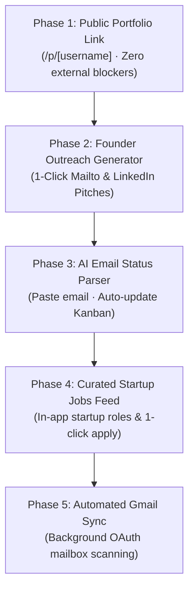

# Feature Implementation Roadmap — Prioritized by "Doable First"

> **Platform:** CareerPilot (AI Job Application Analyzer)  
> **Objective:** Systematically adopt the highest-leverage features from [Aarivi](https://aarivi.com/) and modern AI career tools.  
> **Prioritization Principle:** **"Doable First"** — Features with existing architectural primitives and zero external blocker dependencies are executed first, delivering immediate value before tackling complex third-party OAuth verifications.

---

## 1. Feasibility & Priority Matrix

| Phase | Feature | Complexity | External Blockers | Time to Value | Priority Rank |
| :---: | :--- | :---: | :---: | :---: | :---: |
| **Phase 1** | **Public Shareable Candidate Portfolio (`/p/[username]`)** | Low | None (Internal data) | **Immediate (< 1 day)** | **P0 (Start Here)** |
| **Phase 2** | **Founder & Recruiter Outreach Generator** | Low–Med | None (Uses existing OpenAI & JD data) | **Very Fast (1–2 days)** | **P1** |
| **Phase 3** | **AI Email Parser & One-Click Application Status Updater** | Low–Med | None (In-app AI parsing) | **Fast (1–2 days)** | **P2** |
| **Phase 4** | **Curated Startup Jobs Explorer Feed** | Medium | Internal database seeding / crawler | **Medium (2–3 days)** | **P3** |
| **Phase 5** | **Automated Gmail OAuth Two-Way Sync** | High | Google Cloud OAuth verification & refresh tokens | **Later (4–5 days)** | **P4** |

---

## Phase 1: Public Shareable Candidate Portfolio (`/p/[username]`)
*Priority: P0 — Immediate Doability*

### 1. Why Doable First?
We already completed:
- `Profile` model with `headline`, `bio`, `website`, `linkedin`, `github`, and `experience` (LinkedIn-style timeline).
- Interactive `ExperienceTimeline` component with company badges, duration calculations, and skills pills.
- User authentication and database records.

We only need to expose an unauthenticated public route and a public-facing layout so candidates can share their profile link directly with recruiters, founders, and on their resumes.

### 2. Implementation Steps
1. **Database Update (`prisma/schema.prisma`)**:
   - Add `isPublic Boolean @default(true)` and `username String? @unique` to `model Profile`.
   - Run `npx prisma db push` and `npx prisma generate`.
2. **Server Action (`src/app/actions/profile.ts`)**:
   - `getPublicProfileByUsernameAction(username: string)`: Public query fetching profile and experience without requiring login session.
   - `toggleProfilePublicAction(isPublic: boolean, customUsername?: string)`.
3. **Public Route (`src/app/(public)/p/[username]/page.tsx`)**:
   - Standalone clean page (no dashboard sidebar).
   - High-end developer aesthetic: candidate avatar, headline, social pills (GitHub, LinkedIn, Portfolio), "Download Resume" button, skills radar, and full interactive Experience Timeline.
4. **Dashboard Integration**:
   - Add "Copy Public Link" and "Public / Private Toggle" to `src/app/(dashboard)/profile/profile-client.tsx` and `profile-modal.tsx`.

---

## Phase 2: Direct Founder & Recruiter Outreach Generator
*Priority: P1 — Very High Doability*

### 1. Why Doable Next?
Aarivi’s standout feature is bypassing ATS systems by directly emailing founders and hiring managers.
We already have:
- Parsed Job Descriptions (`JobAnalysis`: company, position, required skills, responsibilities, keywords).
- Uploaded Resumes (`Resume`: candidate background, target role, top projects).
- OpenAI client (`src/lib/openai.ts`) already operational.

### 2. Implementation Steps
1. **Server Action (`src/app/actions/outreach.ts`)**:
   - `generateOutreachPitchAction({ applicationId, outreachType })`:
     - `FOUNDER_DIRECT_PITCH`: Punchy, product-focused cold email citing candidate’s 2 most relevant projects that solve the startup’s specific pain points.
     - `HIRING_MANAGER_TECH_NOTE`: Technical depth, architecture, and tech stack alignment.
     - `LINKEDIN_CONNECTION_NOTE`: Under 300 characters, high acceptance rate, customized to company mission.
2. **UI Component (`src/components/dashboard/outreach-modal.tsx`)**:
   - Embedded into each application card in Kanban and application details page (`/dashboard/applications/[id]`).
   - One-click tabs: `Founder Email`, `Recruiter InMail`, `LinkedIn Note`.
   - "Copy to Clipboard" with toast feedback.
   - **"Open in Gmail / Default Mailer" (`mailto:`) button**: Automatically opens the user's native email client with the subject and body pre-filled, so it sends directly from their authentic address with zero OAuth friction!

---

## Phase 3: AI Email Parser & One-Click Application Status Updater
*Priority: P2 — High Doability (Smart Alternative to Complex OAuth)*

### 1. Why Doable Before Full Gmail OAuth?
Full Gmail OAuth requires Google Developer Console verification, privacy policy compliance, and sensitive scope reviews. 
A lightweight, instant in-app AI email parser delivers 80% of the value with 0% of the friction:

### 2. Implementation Steps
1. **Server Action (`src/app/actions/email-parser.ts`)**:
   - `parseApplicationEmailAction(emailRawText: string)`:
     - Prompts GPT to analyze email text and detect:
       - Company Name
       - Role Title
       - Email Intent: `CONFIRMATION_RECEIVED` (Applied), `INTERVIEW_INVITATION` (Interview), `REJECTION` (Rejected), `OFFER_EXTENDED` (Offer).
       - Key Dates (e.g., Interview date/time if mentioned).
2. **UI Component (`src/components/dashboard/quick-email-log-dialog.tsx`)**:
   - In Kanban Board header: `+ Sync / Paste Email` button.
   - User simply pastes any email snippet received from a recruiter or ATS.
   - AI highlights the detected status change and automatically advances or creates the corresponding Kanban card!

---

## Phase 4: Curated Startup Jobs Explorer Feed (`/jobs/explore`)
*Priority: P3 — Medium Doability*

### 1. Concept
Instead of only analyzing jobs when the candidate manually inputs an external URL or JD text, CareerPilot offers an in-app discovery board of hot startup roles (YC companies, high-growth startups, remote-first teams).

### 2. Implementation Steps
1. **Database Schema (`prisma/schema.prisma`)**:
   - Add `isCurated Boolean @default(false)` and `startupStage String?` (e.g. Seed, Series A, Series B) to `model Job`.
2. **Seed Script / Periodic Ingestion**:
   - Add high-demand engineering listings with verified tech stacks, compensation ranges, and company backgrounds.
3. **Explore View (`src/app/(dashboard)/jobs/explore/page.tsx`)**:
   - Grid cards with startup logos, stage badges, tech stack pills, and remote tags.
   - One-click "Analyze Fit with My Resume" -> runs instant ATS scoring without manual copy-pasting.
   - One-click "Add to Pipeline & Draft Pitch" -> creates application and drafts cold email.

---

## Phase 5: Automated Two-Way Gmail OAuth Sync
*Priority: P4 — Advanced Automation (Post-Core)*

### 1. Concept
The full automated Aarivi background experience:
- Connects Google account with `gmail.readonly` scope.
- Runs scheduled background tasks to scan inbox for recruiter keywords (`"interview"`, `"application received"`, `"unfortunately"`).
- Automatically moves cards across Kanban columns and dispatches in-app notifications.

---

## Recommended Execution Order

We will proceed with **Phase 1 (Public Portfolio)** first, followed immediately by **Phase 2 (Founder Outreach Generator)**.
